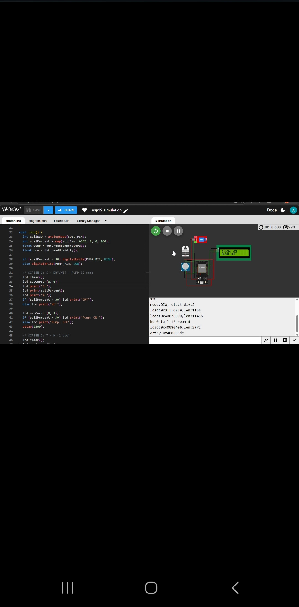

# Smart Agriculture Monitoring - ESP32 Wokwi 🌱
> Aspiring MEXT Scholar Research Project | B.E. 1st Year @ Jiwaji University | Target Japan 2030

This project is part of my early research profile building for MEXT & Honjo Scholarship, focusing on IoT + AgriTech for precision farming.

### 🚀 Live Simulation
**Wokwi Link:** https://wokwi.com/projects/479129217587863553
**GitHub Link:** https://github.com/anshuchhipa2008-afk/smart-agriculture-esp32-wokwi

### 🎯 Problem Statement
In India, water wastage in traditional farming is high. This system automates irrigation based on real-time soil moisture to save water.

### 🛠️ Components Used
- ESP32 DevKit V1
- DHT22 Sensor (Temperature & Humidity)
- Potentiometer (Soil Moisture Simulation)
- LCD 1602 I2C Display
- Jumper Wires

### 🔌 Wiring Details
- LCD SDA -> ESP32 D21
- LCD SCL -> ESP32 D22
- DHT DATA -> ESP32 D4
- POT Signal -> ESP32 D34
- VCC -> 3.3V, GND -> GND

### ⚙️ Working
System reads temperature, humidity from DHT22 and soil moisture from potentiometer, then displays on LCD and controls water pump based on soil moisture threshold.

### ✅ Level 3 - Wokwi Test Proof (Verified)

#### 1. DRY Condition (Soil 0%) - Pump ON

#### 2. WET Condition (Soil 80%) - Pump OFF

#### 3. DHT22 Sensor Working

**Result:** Soil Moisture Threshold Logic Verified - DRY=ON, WET=OFF

### 🔮 Future Scope (For MEXT Research Proposal)
- Cloud integration with Firebase / Blynk
- AI-based crop prediction using sensor data
- LoRaWAN for long-range farm connectivity
- Solar-powered autonomous nodes

### 👨‍🎓 Author
**Anshu Chhipa** - B.E. 1st Year @ Jiwaji University, Gwalior
Aspiring MEXT & Honjo Scholar Japan 2030 | IoT + AgriTech
